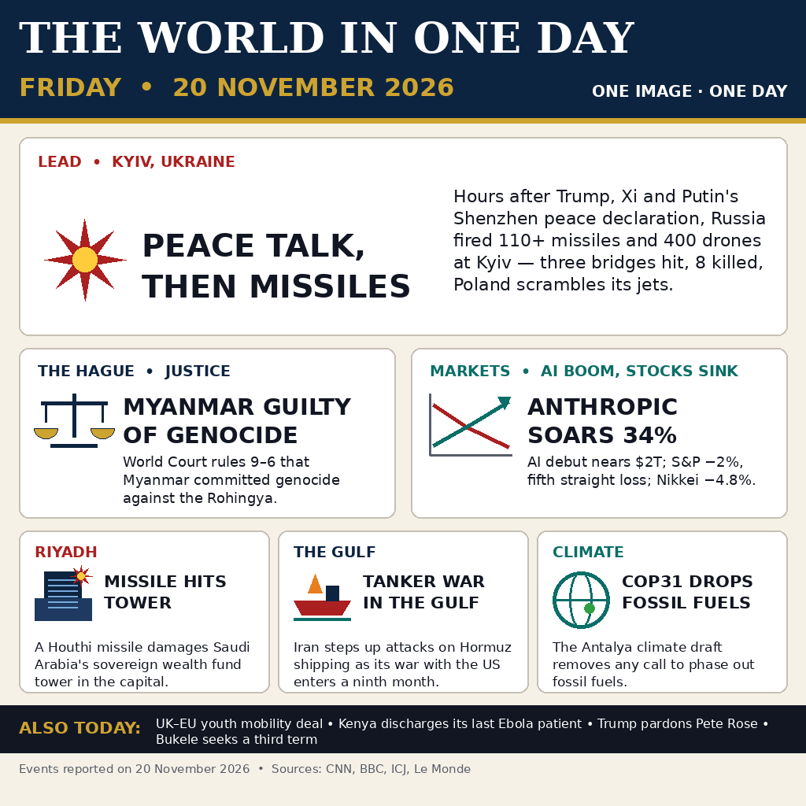

# news-image-20261120-adiznth

[](https://make.fun/bounty/news-image-20261120?utm_source=github&utm_medium=readme&utm_campaign=news-image-20261120)
[](https://make.fun/bounty/news-image-20261120/leaderboard?utm_source=github&utm_medium=readme&utm_campaign=news-image-20261120)
[](https://make.fun/bounty/news-image-20261120?utm_source=github&utm_medium=readme&utm_campaign=news-image-20261120)

One newspaper-style image that sums up the world's news of Friday 20 November 2026 — the day's biggest stories, drawn as a front page so a reader who missed the day can catch up from the picture alone.



## What's on the page

- **Lead — Kyiv:** hours after Trump, Xi and Putin's Shenzhen peace declaration, Russia fires 110+ missiles and 400 drones at Kyiv — three bridges hit, 8 killed, and Poland scrambles jets after its airspace is violated.
- **The Hague:** the International Court of Justice rules 9–6 that Myanmar committed genocide against the Rohingya — the first such finding against a state.
- **Markets:** Anthropic's shares soar 34% on debut, nearing a $2 trillion value, while the S&P 500 falls 2% for a fifth straight session and the Nikkei drops 4.8%.
- **Riyadh:** a Houthi missile damages Saudi Arabia's sovereign wealth fund tower in the capital's financial district.
- **The Gulf:** Iran steps up attacks on tankers in the Strait of Hormuz as its war with the US enters a ninth month.
- **Climate:** the COP31 draft deal in Antalya drops any call to phase out fossil fuels.
- **Also today:** a UK–EU youth mobility deal, Kenya discharges its last Ebola patient, Trump pardons baseball legend Pete Rose, and El Salvador's Bukele seeks a third term.

Every story above was reported on 20 November 2026 (sources: CNN, BBC, ICJ, Le Monde).

## How it is made

`draw.py` draws the front page with Pillow (build time only): masthead, icons and text, all laid out in code — no photographs, no copied artwork. `entry.png` is the finished 1024×1024 image it produces. `main.py` is the entry program: it copies `entry.png` to the output directory, using the Python standard library only, so it runs offline and writes identical bytes on every run.

## Run it

```sh
mkdir -p out && MAKEFUN_OUTPUT_DIR=out python3 main.py
```
